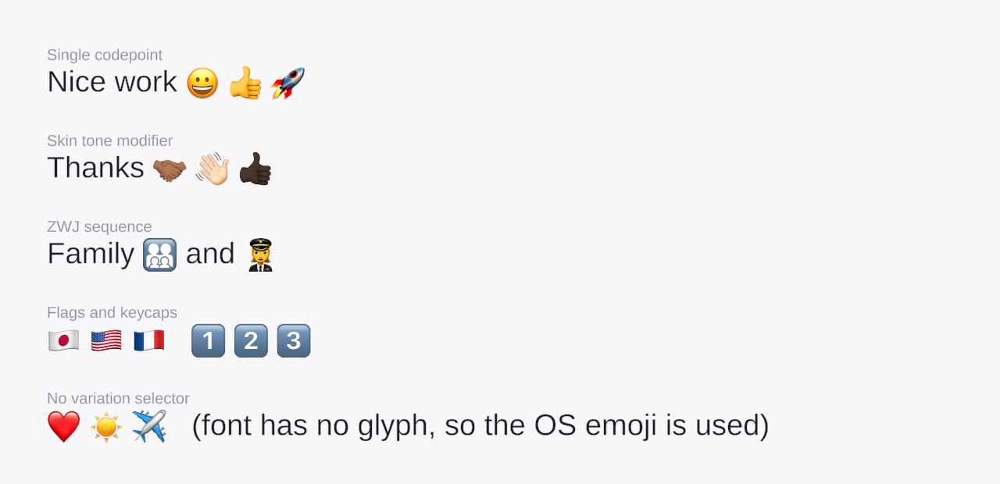

# Native Emoji for TextMeshPro

**Render emoji in Unity's TextMeshPro using the OS's own emoji font — no emoji images bundled.**

<p>
  
  
  
</p>



TextMeshPro のテキストに含まれる絵文字を、**OS に実行時に描かせて表示する**プラグイン。

絵文字の画像をプロジェクトに同梱しない。Apple の絵文字は再配布が規約で禁じられているため、
スプライトシートを持たず、端末の OS に描かせたものをその場でテクスチャ化して使う。

> **English:** A Unity plugin that renders emoji in TextMeshPro by asking the OS to draw them at
> runtime, instead of shipping an emoji sprite sheet. Apple's emoji cannot be redistributed, so
> nothing is bundled — glyphs are drawn on the device and packed into a runtime atlas.
> Drop it in and every TMP text works; no component to attach. Documentation is in Japanese.

## 特徴

- **導入するだけ。** コンポーネントの追加は不要で、シーン内のすべての TMP テキストに効く
- **最初のフレームから表示される。** 豆腐（□）が一瞬見えることがない
- **合成シーケンスに対応。** ZWJ・肌色修飾子・国旗・キーキャップを 1 文字として正しい大きさで表示
- **絵文字画像を同梱しない。** ビルドサイズが増えず、再配布の問題を避けられる
- **フォントの記号を壊さない。** ⭐ のようにフォントが持つ記号は今までどおりフォントで描かれる

## 動作環境

| | |
|---|---|
| Unity | 6000.3.x（TextMeshPro は `com.unity.ugui` 2.0.0 同梱版） |
| iOS | 実機確認済み |
| Android | ネイティブ実装はあるが**未検証** |
| macOS Editor | 確認済み |
| 上記以外 | **非対応**（スタンドアロン・WebGL・Windows / Linux の Editor）。何もせず、TMP の通常表示のままになる |

## 導入

TextMeshPro の Essential Resources が未インポートなら先に入れる
（`Window > TextMeshPro > Import TMP Essential Resources`）。

### Package Manager（UPM / 推奨）

`Window > Package Manager > + > Install package from git URL...` に次を貼る。

```
https://github.com/kabatin/unity-emoji-plugin.git?path=UnityProject/Assets/NativeEmoji
```

`Packages/manifest.json` に直接書いてもよい。

```json
{
  "dependencies": {
    "com.kabatin.native-emoji": "https://github.com/kabatin/unity-emoji-plugin.git?path=UnityProject/Assets/NativeEmoji"
  }
}
```

版を固定する場合は末尾に `#v1.0.0` のようにタグを付ける。

```
https://github.com/kabatin/unity-emoji-plugin.git?path=UnityProject/Assets/NativeEmoji#v1.0.0
```

### .unitypackage

[Releases](https://github.com/kabatin/unity-emoji-plugin/releases) から
`native-emoji-x.y.z.unitypackage` を落として、`Assets > Import Package > Custom Package...` で入れる。

### 導入後

**それだけ。** 最初のシーンを読み込む前に自動で有効になり、すべての TMP テキストに効く。

自動で有効にしたくない場合は、スクリプトシンボル `NATIVE_EMOJI_DISABLE_AUTO_INSTALL` を定義し、
任意の時点で `NativeEmojiSprite.Install()` を呼ぶ。

### 導入側で必要な対応

<details>
<summary><b>1. 既存の絵文字スプライトシートを外す</b></summary>

TMP Settings の `Default Sprite Asset` と、ビルド時にそれを設定するスクリプトがあれば両方。
**参照が残るとシートがビルドに含まれる**（Apple の絵のシートなら再配布にあたる）。

絵文字以外の独自スプライトを既定アセットに入れている場合は、そのままでよい。
元の既定アセットはフォールバックとして残るので、`<sprite name="...">` は今までどおり引ける。
アセット名を付けない `<sprite index=N>` だけは実行時アセットを指すようになるので、名前で引く形に直す。
</details>

<details>
<summary><b>2. スプライト用シェーダがビルドに含まれていること</b></summary>

TMP Essentials の `Resources/Sprite Assets/EmojiOne.asset` があれば、その material の参照で含まれる
（プラグインは既存の既定スプライトアセットのシェーダを優先して使う）。
無い場合は Project Settings の Always Included Shaders に `TextMeshPro/Sprite` を入れる。
</details>

<details>
<summary><b>3. 独自の前処理（ITextPreprocessor）を持つテキスト</b></summary>

プラグイン側から前処理を付けられないので、その前処理の中で `NativeEmojiTextProcessor.Process` を呼ぶ。

**文字数を変えるほかの置換の後、異体字セレクタの除去より前**に呼ぶこと
（異体字セレクタは合成シーケンスの一部）。

```csharp
public sealed class MyTextPreprocessor : ITextPreprocessor
{
    private readonly TMP_Text _text;

    public MyTextPreprocessor(TMP_Text text) => _text = text;

    public string PreprocessText(string text)
    {
        text = ReplaceMyTags(text);                                      // 文字数を変えるほかの置換
        text = NativeEmojiTextProcessor.Process(text, _text.richText);   // 絵文字の登録と置き換え
        return StripVariationSelectors(text);                            // 異体字セレクタを除くなら最後に
    }
}
```
</details>

<details>
<summary><b>4. Android で minify を使っている場合</b></summary>

Java クラスが削られないよう、プロジェクトの proguard ファイルに
`Plugins/Android/proguard-rules.pro` と同じ keep ルールを足す
（プラグイン内の `.pro` は自動では使われない）。
</details>

## 仕組み

起動時に、画像を持たない空の `TMP_SpriteAsset` を作って `TMP_Settings.defaultSpriteAsset` に差し替える。
TMP の前処理（`ITextPreprocessor`）で絵文字を見つけたら、OS に描かせてアトラスに書き込み、
スプライトとして登録する。

```
テキスト → TMP の前処理で絵文字を検出
        → OS のネイティブ API で描画（iOS: UIKit / Android: Canvas / macOS: AppKit）
        → 実行時アトラスのマスへ GPU コピー
        → 合成シーケンスは <sprite index=N> に置き換え
        → TMP 自身がメッシュを作って描画
```

前処理は TMP がメッシュを作る直前に**同期で**走るので、同じ Canvas 更新の中で登録が済む。
オーバーレイや頂点操作は使わない。

単独のコードポイント（😀 など）はタグに置き換えず unicode で登録するだけにしている。
TMP は「フォント → フォールバック → 既定スプライトアセット」の順に探すので、
フォントが持つ記号（⭐ など）は今までどおりフォントで描かれる。

設計上の判断とその理由は [docs/DEVELOPMENT.md](./docs/DEVELOPMENT.md)。

## 公開 API

| | |
|---|---|
| `NativeEmojiSprite.Install()` | 有効にする。非対応の環境、TMP Settings が無い、シェーダが見つからない場合は false |
| `NativeEmojiSprite.Uninstall()` | 元に戻し、登録した絵文字とアトラスを破棄する |
| `NativeEmojiSprite.IsInstalled` | 有効かどうか |
| `NativeEmojiTextProcessor.Process(text, richText)` | 独自の前処理から呼ぶ |
| `NativeBridge.IsSupported` | この実行環境で OS に絵文字を描かせられるか |

## 既知の制限

- 数値を差し込む `SetText(書式, float…)`、StringBuilder 版、char[] 版は前処理を通らないため、
  未登録の絵文字は豆腐のまま出る
- リッチテキストが無効のテキストでは、合成シーケンスが構成要素に分かれて表示される
- `TMP_InputField` の入力欄でも、合成シーケンスは構成要素に分かれて表示される
  （タグに置き換えるとキャレット位置がずれるため、入力欄の本文は書き換えない）
- 1 セッションで 400 個まで（2048² のアトラスに 96px のマス）
- 新しい絵文字を多く含む画面を初めて開くと一瞬重くなりうる（Editor で 20 個 約 30ms。
  大半は OS の初回のグリフ描画）
- Edit Mode（Prefab 編集画面など）では絵文字は出ない。実行時だけの仕組み
- OS が描けない絵文字は、OS が返す豆腐がそのまま登録される
- アトラスは GPU 上に約 16MB
- Android は未検証
- iOS / Android の実機と macOS の Editor 以外では動かない（自動有効化もされない）

## 絵文字画像の扱い

描いた画像は**メモリ上のアトラスにだけ持つ**。ディスクへのキャッシュ、サーバーへの送信、
アセットへの書き出しはしない。Apple 絵文字の再配布にあたらないようにするための線引きで、
商用利用の前に法務確認を推奨する。

このリポジトリには Unity 提供の TextMesh Pro Essentials を含めていない
（上記と同じ理由で、他者のアセットを再配布しないため）。

## 開発

```bash
UNITY="/Applications/Unity/Hub/Editor/6000.3.6f1/Unity.app/Contents/MacOS/Unity"

# EditMode（パーサ・ネイティブ描画の契約・スプライト登録）
"$UNITY" -batchmode -projectPath UnityProject \
  -runTests -testPlatform EditMode -testResults /tmp/em.xml -logFile /tmp/em.log

# PlayMode（Canvas 更新を通した表示の検証）
"$UNITY" -batchmode -projectPath UnityProject \
  -runTests -testPlatform PlayMode -testResults /tmp/pm.xml -logFile /tmp/pm.log
```

PlayMode は `-nographics` を付けない（ネイティブ描画が AppKit を使う）。

絵文字判定テーブルの再生成は Unity メニューの
`Tools > Native Emoji > Regenerate Codepoint Tables`。

配布用の `.unitypackage` の書き出しは `Tools > Native Emoji > Export .unitypackage`
（`dist/` に出る）。バッチモードからも呼べる。

```bash
"$UNITY" -batchmode -projectPath UnityProject -logFile -   -executeMethod NativeEmoji.Editor.NativeEmojiPackageExporter.ExportFromCommandLine
```

パッケージのテストを利用側プロジェクトで走らせる場合は、`Packages/manifest.json` に
`"testables": ["com.kabatin.native-emoji"]` を足す。

設計判断・テストの流し方・残っている作業は [docs/DEVELOPMENT.md](./docs/DEVELOPMENT.md)。

## ライセンス

[MIT](./LICENSE)

このプラグイン自体のライセンスであり、OS が描画する絵文字の意匠には及ばない。
